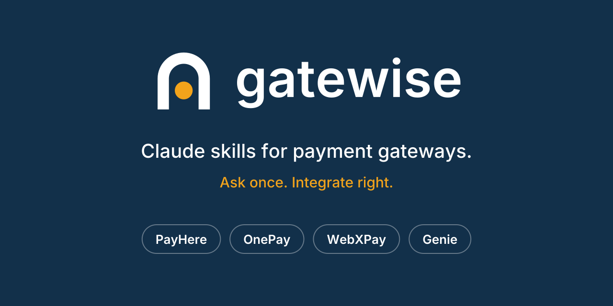

<p align="center">
  
</p>

<p align="center">
  <b>Teach Claude the payment gateway you're integrating, so the code it writes actually works.</b>
</p>

<p align="center">
  <a href="#install-in-2-minutes">Install</a> ·
  <a href="#what-to-ask">What to ask</a> ·
  <a href="#supported-gateways">Gateways</a> ·
  <a href="#how-good-is-it">Test results</a> ·
  <a href="docs/adding-a-gateway.md">Add a gateway</a>
</p>

<p align="center">
  <a href="https://github.com/psnwd/getewise/actions/workflows/verify.yml"></a>
  
  
</p>

---

## What is this?

Payment gateways have odd rules: a hash that must be built in a very specific order, a status code that means "success" on one gateway and "declined" on another, a feature that only works on the live site, never the sandbox.

Claude doesn't know these details well. Left alone, it guesses, and a wrong guess in payments means failed checkouts or orders marked paid when they aren't.

**Gatewise fixes that.** Each gateway gets a *skill*: a small folder of notes, checked code examples and a helper script that Claude reads before it answers. You just ask normally. Claude picks the right gateway notes by itself.

> No servers, no accounts, no API keys. It's plain files. Nothing is sent anywhere.

## Supported gateways

| Gateway | Country | What Claude can now help with |
|---|---|---|
| **[PayHere](skills/payhere/SKILL.md)** | Sri Lanka | Checkout, subscriptions, saved cards, refunds, plans and fees, sandbox cards, plugins |
| **[OnePay](skills/onepay/SKILL.md)** | Sri Lanka | Redirect checkout, JS SDK, payment links, card on file, refunds, payouts, plugins |
| **[WebXPay](skills/webxpay/SKILL.md)** | Sri Lanka | RSA-encrypted checkout, saved cards and recurring (Token V2), gateway IDs, plugins |
| **[Genie Business](skills/genie/SKILL.md)** | Sri Lanka | Dialog Pay Business: hosted checkout, webhooks and signatures, card on file, recurring (MIT), refunds, plugins |

Every gateway skill covers both **writing the integration** (Node/TypeScript, Go, Python, PHP/Laravel, Rust, Java, C#) and **answering support questions** (fees, limits, error codes, "why did this fail?"). More gateways are planned, see the [roadmap](ROADMAP.md).

## What to ask

Just talk to Claude as you normally would:

- *"Add PayHere checkout to my Express app and verify the payment notification."*
- *"My OnePay refund failed in sandbox, what's wrong?"*
- *"I get WebXPay error 414 when I pick Lanka QR. Why?"*
- *"Can I do monthly subscriptions on PayHere's free plan?"*
- *"Write the WebXPay `payment` field in Go."*
- *"How do I verify a Genie Business webhook before shipping the order?"*

Claude loads only the notes it needs, so answers stay fast and focused.

## Install in 2 minutes

Pick the one that matches how you use Claude.

**Claude.ai (web / desktop app)**
1. Download the gateway you want from [`dist/`](dist) (for example `payhere.skill`).
2. Open **Settings**, find **Skills** (under Capabilities), and upload the file.
3. Start a chat and ask a question.

**Claude Code (plugin, easiest)**

```
/plugin marketplace add psnwd/getewise
/plugin install gatewise@gatewise
```
This installs all gateways. To install just one, use `payhere`, `onepay`, `webxpay` or `genie` instead of `gatewise` in the second command.

**Claude Code (manual copy)**

macOS / Linux:
```bash
git clone https://github.com/psnwd/getewise.git
cp -r getewise/skills/* ~/.claude/skills/
```
Windows (PowerShell):
```powershell
git clone https://github.com/psnwd/getewise.git
Copy-Item -Recurse getewise\skills\* $env:USERPROFILE\.claude\skills\
```
Want just one gateway? Copy only that folder, for example `skills/payhere`.

**Other agents** (Cursor, Codex CLI, Gemini CLI...): copy the skill folder into that tool's skills directory. Each skill is a standard `SKILL.md` plus a `references/` folder.


## How it works

```
 You ask a question
        │
        ▼
 Claude sees "PayHere" / "OnePay" / "WebXPay" / "Genie" in it   ──►  loads that gateway's SKILL.md
        │
        ▼
 SKILL.md says which topic file to read                ──►  references/recurring.md, refund.md ...
        │
        ▼
 Claude answers using those notes, checked code,
 and a helper script (for hashes / signatures)
```

Inside each skill:

```
skills/payhere/
├── SKILL.md          # short guide + routing table + the rules people most often get wrong
├── references/       # one file per topic (checkout, recurring, refunds, errors, code...)
└── scripts/          # tiny tools, e.g. build or verify a request hash
```

## How good is it?

Each skill was tested on three realistic questions, once with the skill and once without it. Answers were graded against a checklist taken from the gateway's own docs.

| Gateway | With Gatewise | Without |
|---|---|---|
| PayHere | **100%** | 47% |
| OnePay | **100%** | 27% |
| WebXPay | **100%** | 53% |
| Genie Business | **100%** | 53% |

What the "without" answers got wrong: invented endpoints, a made-up signature scheme, "no paid plans exist", treating a *declined* status code as success, and skipping the webhook signature check. Full numbers are in [`docs/benchmarks`](docs/benchmarks).

**Be honest about the limits:** that's three questions per gateway, one run each, so treat it as a strong signal and not a guarantee. The hash and encryption code was run and checked for the languages noted in each skill, but nothing here was tested against a live merchant account.

## Good to know

- **Unofficial.** Gatewise isn't made by or affiliated with PayHere, OnePay, WebXPay, Genie Business (Dialog) or their banks. Names belong to their owners.
- **Docs change.** Notes come from each gateway's public docs (read October 2026). Fees, limits and policies can change, and each skill tells Claude to say so and send contract questions to the gateway.
- **Gaps are flagged, not guessed.** When a gateway's docs are missing or contradict themselves, the skill lists it in `references/troubleshooting.md` and Claude is told to say so instead of inventing an answer.
- **Test in sandbox first,** then go live. Never paste real secrets into chat.

## Add a gateway

Know another gateway's docs? Adding one takes an afternoon:

1. Copy [`templates/gateway-skill`](templates/gateway-skill) to `skills/<name>`.
2. Fill the reference files from the gateway's docs.
3. Add three test questions under `evals/<name>`.
4. Run `python scripts/package.py <name>`, add the skill to `.claude-plugin/marketplace.json`, then `python scripts/verify.py`.

Full steps: [docs/adding-a-gateway.md](docs/adding-a-gateway.md). Contributions welcome, see [CONTRIBUTING.md](CONTRIBUTING.md).

## Project layout

```
gatewise/
├── skills/        one folder per gateway (this is what you install)
├── dist/          ready-to-upload .skill files
├── .claude-plugin/ plugin + marketplace manifests (for /plugin install)
├── .github/       CI (verify on every PR) and release workflow
├── evals/         the test questions and graders for each skill
├── docs/          benchmarks, logo notes, how to add a gateway
├── templates/     blank starter for a new gateway
├── scripts/       package.py (build .skill files), verify.py (CI checks)
└── assets/        logo, icons, banner
```

## Licence

[MIT](LICENSE), including the logo and brand assets.
